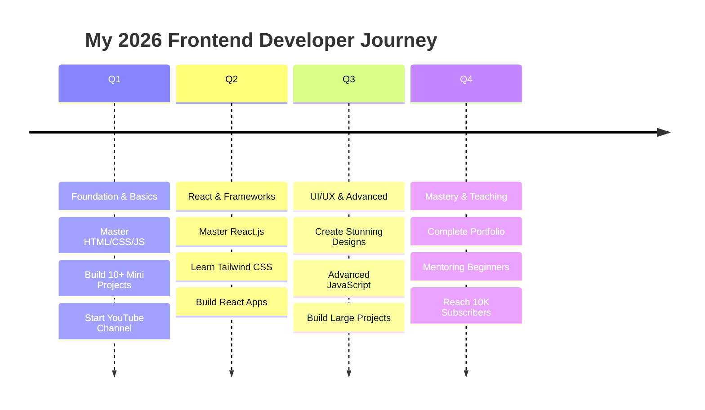

<p align="center">
  
</p>

<h1 align="center">
  
</h1>

<p align="center">
  
  
  
  
</p>

<p align="center">
  <a href="https://www.youtube.com/@CodeWithNisar">
    
  </a>
  <a href="https://github.com/CodeWithNisar">
    
  </a>
  <a href="mailto:your.email@gmail.com">
    
  </a>
  <a href="#">
    
  </a>
  <a href="#">
    
  </a>
</p>

---

## 🧑‍💻 **About Me**

<table align="center">
<tr>
<td width="60%">

### 🚀 **My Journey**

Hey there! I'm **Nisar Alee**, a passionate **Frontend Web Developer** on a mission to make programming accessible to everyone. What started as curiosity has transformed into a burning passion for building, learning, and teaching.

**🎯 What Drives Me:**
- 💻 **Building** - Creating beautiful UI/UX that users love
- 📚 **Learning** - Mastering new frontend technologies every single day
- 🎥 **Teaching** - Sharing knowledge in Hindi/Urdu + English
- 🌟 **Inspiring** - Showing that anyone can become a developer

**📚 Current Focus:**
- ⚛️ Mastering React.js & Modern JavaScript
- 🎨 Creating Stunning UI/UX Designs
- 📱 Mastering Responsive & Mobile-First Design
- 📝 Producing Educational Content

</td>
<td width="40%">

<div style="background: #0B0B0B; padding: 20px; border-radius: 15px; border: 1px solid #F5B301;">

```bash
root@CodeWithNisar:~$ whoami

👤 Name        : Nisar Alee
🎯 Alias       : CodeWithNisar
💼 Role        : Frontend Developer
🌍 Location    : Pakistan
💻 Tech Stack  : HTML • CSS • JS • React
📚 Currently   : Advanced React • Tailwind
🎥 YouTube     : Urdu + English
🚀 Mission     : Making Frontend Simple
🔥 Dream       : Inspire 100,000+ Developers
⚡ Status      : Building • Learning • Teaching
```

</div>

</td>
</tr>
</table>

> 💡 *"The best way to predict your future is to create it with code."*

---

## ⚡ **Frontend Tech Stack**

<p align="center">

</p>
### 📊 **Skill Proficiency**

<p align="center">
  <table>
    <tr>
      <td width="33%" align="center">
        <b>🌐 Core Frontend</b><br>
        <br>
        <span style="font-size: 14px;">HTML5 • CSS3 • JavaScript</span>
      </td>
      <td width="33%" align="center">
        <b>⚛️ Frameworks & Libraries</b><br>
        <br>
        <span style="font-size: 14px;">React • Tailwind • Bootstrap</span>
      </td>
      <td width="33%" align="center">
        <b>🎨 Design & Tools</b><br>
        <br>
        <span style="font-size: 14px;">Figma • Git • VSCode</span>
      </td>
    </tr>
  </table>
</p>

---

## 📊 **GitHub Analytics**

<p align="center">
  
  
</p>

<p align="center">
  
</p>

---

## 🏆 **Achievements**

<p align="center">
  
</p>

---

## 📈 **Contribution Graph**

<p align="center">
  
</p>

---

## 🐍 **Contribution Snake**

<p align="center">
  
</p>

---

## 🚀 **Current Mission**

<p align="center">
  <table>
    <tr>
      <td align="center" width="33%">
        <h3>📚 Learning</h3>
        <ul style="text-align: left;">
          <li>⚛️ React.js Mastery</li>
          <li>🎨 Advanced Tailwind</li>
          <li>📱 Responsive Design</li>
          <li>🧩 JavaScript ES6+</li>
        </ul>
      </td>
      <td align="center" width="33%">
        <h3>💻 Building</h3>
        <ul style="text-align: left;">
          <li>🌐 Portfolio Website</li>
          <li>🛒 E-Commerce UI</li>
          <li>📝 Todo App</li>
          <li>🌦️ Weather Dashboard</li>
        </ul>
      </td>
      <td align="center" width="33%">
        <h3>🎥 Teaching</h3>
        <ul style="text-align: left;">
          <li>📘 HTML/CSS Course</li>
          <li>⚡ JavaScript Tutorials</li>
          <li>⚛️ React Playlist</li>
          <li>🎨 Responsive Designs</li>
        </ul>
      </td>
    </tr>
  </table>
</p>

<div align="center">
  
  
  
</div>

---

## 💻 **Featured Frontend Projects**

<p align="center">
  <table>
    <tr>
      <td width="50%">
        <div style="background: #0B0B0B; padding: 15px; border-radius: 15px; border: 1px solid #F5B301;">
          <h3>🌐 <b>Portfolio Website</b></h3>
          <p>Modern animated portfolio with dark theme</p>
          <p>
            
            
            
          </p>
          <p><span style="color: #F5B301;">✅ Completed</span> · <a href="#"><b>Live Demo</b></a> · <a href="#"><b>Code</b></a></p>
        </div>
      </td>
      <td width="50%">
        <div style="background: #0B0B0B; padding: 15px; border-radius: 15px; border: 1px solid #F5B301;">
          <h3>🧠 <b>JavaScript Projects</b></h3>
          <p>100+ practice projects for beginners</p>
          <p>
            
            
            
          </p>
          <p><span style="color: #F5B301;">✅ Completed</span> · <a href="#"><b>Live Demo</b></a> · <a href="#"><b>Code</b></a></p>
        </div>
      </td>
    </tr>
    <tr>
      <td width="50%">
        <div style="background: #0B0B0B; padding: 15px; border-radius: 15px; border: 1px solid #F5B301;">
          <h3>🌦️ <b>Weather App UI</b></h3>
          <p>Real-time weather dashboard</p>
          <p>
            
            
          </p>
          <p><span style="color: #FFD700;">🔄 In Progress</span> · <a href="#"><b>Live Demo</b></a> · <a href="#"><b>Code</b></a></p>
        </div>
      </td>
      <td width="50%">
        <div style="background: #0B0B0B; padding: 15px; border-radius: 15px; border: 1px solid #F5B301;">
          <h3>🔐 <b>Password Generator</b></h3>
          <p>Secure password generator with strength meter</p>
          <p>
            
            
          </p>
          <p><span style="color: #F5B301;">✅ Completed</span> · <a href="#"><b>Live Demo</b></a> · <a href="#"><b>Code</b></a></p>
        </div>
      </td>
    </tr>
    <tr>
      <td width="50%">
        <div style="background: #0B0B0B; padding: 15px; border-radius: 15px; border: 1px solid #F5B301;">
          <h3>📝 <b>Notes Application</b></h3>
          <p>CRUD with local storage</p>
          <p>
            
            
            
          </p>
          <p><span style="color: #F5B301;">✅ Completed</span> · <a href="#"><b>Live Demo</b></a> · <a href="#"><b>Code</b></a></p>
        </div>
      </td>
      <td width="50%">
        <div style="background: #0B0B0B; padding: 15px; border-radius: 15px; border: 1px solid #F5B301;">
          <h3>🧮 <b>Calculator App</b></h3>
          <p>Responsive with dark/light mode</p>
          <p>
            
            
            
          </p>
          <p><span style="color: #F5B301;">✅ Completed</span> · <a href="#"><b>Live Demo</b></a> · <a href="#"><b>Code</b></a></p>
        </div>
      </td>
    </tr>
  </table>
</p>

---

## 💻 **Developer Terminal**

<p align="center">
  <div style="background: #0B0B0B; border: 2px solid #F5B301; border-radius: 15px; padding: 20px; max-width: 700px; text-align: left; font-family: 'Courier New', monospace;">
    <div style="display: flex; align-items: center; margin-bottom: 15px;">
      <span style="display: inline-block; width: 12px; height: 12px; background: #ff5f56; border-radius: 50%; margin: 0 5px;"></span>
      <span style="display: inline-block; width: 12px; height: 12px; background: #ffbd2e; border-radius: 50%; margin: 0 5px;"></span>
      <span style="display: inline-block; width: 12px; height: 12px; background: #27c93f; border-radius: 50%; margin: 0 5px;"></span>
      <span style="margin-left: 10px; color: #8892b0;">CodeWithNisar@terminal</span>
    </div>
    <pre style="color: #F5B301; margin: 0; line-height: 1.8; font-size: 14px;">
┌─────────────────────────────────────────────────────────┐
│ root@CodeWithNisar:~$ skills                          │
│                                                       │
│ ✅ HTML5          ████████████████████░ 90%         │
│ ✅ CSS3           ███████████████████░░ 85%         │
│ ✅ JavaScript     ██████████████████░░░ 80%         │
│ ✅ Tailwind CSS   ████████████████░░░░ 75%         │
│ ✅ Bootstrap      ████████████████░░░░ 75%         │
│ ✅ React.js       ██████████████░░░░░░ 70%         │
│ ✅ Git & GitHub   ██████████████████░░░ 80%         │
│ ✅ Responsive     ███████████████████░░ 85%         │
│                                                       │
│ root@CodeWithNisar:~$ currently                      │
│                                                       │
│ 🏗️ Building... 🎓 Teaching... 📚 Learning...        │
│                                                       │
│ root@CodeWithNisar:~$ motto                         │
│                                                       │
│ "Code Every Day. Learn Every Day. Teach Every Day."  │
│                                                       │
│ root@CodeWithNisar:~$ status                        │
│                                                       │
│ ████████████████████████████████████████ 100%      │
│                                                       │
│ root@CodeWithNisar:~$ exit                          │
│ Happy Coding! 🚀                                     │
└─────────────────────────────────────────────────────────┘
    </pre>
  </div>
</p>

---

## 🤝 **Open Source**

```bash
# Clone the repository
git clone https://github.com/CodeWithNisar/CodeWithNisar.git

# Navigate to the directory
cd CodeWithNisar

# Create a new branch
git checkout -b feature/awesome

# Make your changes and commit
git commit -m "✨ Add awesome feature"

# Push your changes
git push origin feature/awesome

# Create a Pull Request 🚀
```

> **💡 Tip:** All contributions are welcome! Whether it's fixing bugs, improving documentation, or adding new features.

---

## 🌟 **Support My Mission**

<div align="center">
  <table>
    <tr>
      <td align="center" width="25%">
        <span style="font-size: 40px;">⭐</span><br>
        <b>Star</b><br>
        <span style="font-size: 13px; color: #8892b0;">Show appreciation</span>
      </td>
      <td align="center" width="25%">
        <span style="font-size: 40px;">🍴</span><br>
        <b>Fork</b><br>
        <span style="font-size: 13px; color: #8892b0;">Contribute & improve</span>
      </td>
      <td align="center" width="25%">
        <span style="font-size: 40px;">📺</span><br>
        <b>Subscribe</b><br>
        <span style="font-size: 13px; color: #8892b0;">YouTube channel</span>
      </td>
      <td align="center" width="25%">
        <span style="font-size: 40px;">💙</span><br>
        <b>Share</b><br>
        <span style="font-size: 13px; color: #8892b0;">With your friends</span>
      </td>
    </tr>
  </table>
  
  <p>
    <a href="https://www.youtube.com/@CodeWithNisar">
      
    </a>
    <a href="https://github.com/CodeWithNisar">
      
    </a>
    <a href="#">
      
    </a>
  </p>
</div>

---

## 🎯 **2026 Frontend Roadmap**



---

<p align="center">
  
</p>

<p align="center">
  <b>🌟 Made with ❤️ by CodeWithNisar</b><br>
  <i>"Code Every Day. Learn Every Day. Teach Every Day."</i><br><br>
  <a href="#top">⬆️ Back to Top</a>
</p>

<p align="center">
  
  
  
  
</p>
```
